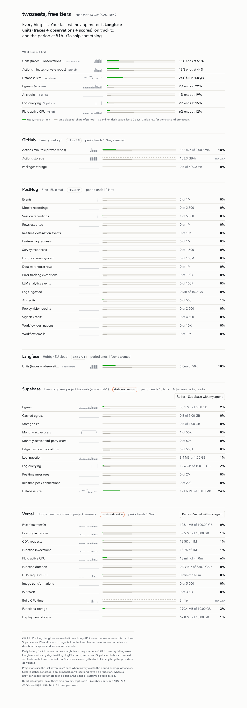

# free-tier-maxxer

One local dashboard for the free tiers behind your side project: how much of every limit you have used, how much of the billing period is left, and what runs out first. Covers GitHub, PostHog, Langfuse, Supabase and Vercel.



## Status: exploration, not a product yet

This repo is the research spike plus a working concept. It already pulls real numbers from your accounts, but the tool described in [docs/initial-brief.md](docs/initial-brief.md) (CLI, local web app, MCP server, agent skill) is not built yet. What is here:

- `feasibility/` — verified findings per provider: which endpoint reports what, with which token scope, and what the free plans hide. Start with [feasibility/README.md](feasibility/README.md).
- `checks/` — dependency-free Node scripts that read usage with read-only tokens, two browser snippets for the providers that have no usage API on free plans (Vercel, Supabase), and a builder that turns the captures into dashboard data.
- `concept/` — the dashboard, a single HTML file rendered from those captures. Ships with sample data so it works before you configure anything.

## Quick start

Requirements: Node 22 or later (20.6 works too). No npm dependencies. A coding agent can do all of this for you, see [Using an agent](#using-an-agent).

```sh
git clone https://github.com/alemalvarez/free-tier-maxxer.git
cd free-tier-maxxer
cp .env.example .env && chmod 600 .env   # then paste your tokens (table below)
npm run check                            # pulls usage from every provider you configured
npm run build                            # writes concept/data.js and concept/series.js from the captures
npm run serve                            # http://127.0.0.1:4321, loopback only
```

Providers you leave empty in `.env` are skipped. Vercel and Supabase need one extra step for most of their numbers, see [the dashboard capture](#vercel-and-supabase-the-dashboard-capture). Until you build, the page shows the bundled sample.

## Provider setup

Every token is read-only. Create them with the minimum scope below; anything else is unnecessary.

| Provider | Token | Where to create it | What it unlocks | What it cannot see |
|---|---|---|---|---|
| GitHub | Fine-grained PAT, account permission **Plan: read-only**, no repository access | github.com → Settings → Developer settings → Personal access tokens → Fine-grained | Actions minutes and storage with per-day rows, Packages storage | Copilot free credit (not published) |
| PostHog | Personal API key, scopes **billing:read** and **query:read**, created by an **organization owner** | PostHog → Settings → Personal API keys. Host is the API host without `.i.`: `https://eu.posthog.com` or `https://us.posthog.com` | Every product's usage, limit and the real billing period; per-day counts via HogQL | Nothing missing |
| Langfuse | Project **public + secret key** (no read-only variant exists; keep it to one project) | Project Settings → API Keys. Host: `cloud.langfuse.com`, `us.cloud.langfuse.com` or `jp.cloud.langfuse.com` | Observations, root observations (used as the trace count) and scores, summed as units of the 50,000 Hobby allowance | Billing period: set `LANGFUSE_BILLING_ANCHOR_DAY` to the day of the month you signed up. Hobby caps the Metrics API at 100 requests/day; a full run uses 7 |
| Supabase | Scoped personal access token with **projects_read** and **database_read** | supabase.com → Account → Access tokens | Project status (paused or not), database size, storage size, approximate MAU, all via read-only SQL | Egress, edge function invocations, realtime, log ingestion. Use the dashboard capture |
| Vercel | Token scoped to your **team** (not a project) | vercel.com → Account → Tokens | Plan, billing cycle, build time per deployment | Everything else on Hobby: bandwidth, requests, invocations, CPU. Use the dashboard capture |

Each `checks/<provider>.mjs` prints what it got and saves the raw JSON under `checks/out/` (git-ignored). A 401 or 403 means the token or scope is wrong; the script says which call failed.

## Vercel and Supabase: the dashboard capture

On free plans these two report usage only to their own dashboards, which are logged-in browser sessions. The repo does not store sessions. Instead you (or your agent) run a small function in a browser where you are already logged in, and save the result as a file. Everything stays on your machine; the functions only talk to `vercel.com` and `api.supabase.com`. Details and what each route returns are in [feasibility/unofficial-vercel.md](feasibility/unofficial-vercel.md) and [feasibility/unofficial-supabase.md](feasibility/unofficial-supabase.md).

**Vercel**

1. Log in to vercel.com and open `https://vercel.com/<your-team>/~/usage`.
2. Open the devtools console, paste the whole of [checks/browser/vercel-usage.js](checks/browser/vercel-usage.js) and press Enter. Chrome asks you to type `allow pasting` the first time.
3. Run `copy(JSON.stringify(await ftmVercelUsage()))`.
4. Paste the clipboard into `checks/out/vercel-dashboard.json`.

If you prefer to save the page's HTML instead, `npm run vercel:parse -- page.html <team-slug>` produces the same file, provided the saved HTML still contains the inline `self.__next_f` scripts.

**Supabase**

1. Log in to supabase.com/dashboard.
2. In the devtools console paste the whole of [checks/browser/supabase-dashboard.js](checks/browser/supabase-dashboard.js).
3. Run `copy(JSON.stringify(await ftmSupabaseDashboard({ orgSlug: '<SUPABASE_ORG_SLUG>', projectRef: '<SUPABASE_PROJECT_REF>' })))` with the values from your `.env`.
4. Paste the clipboard into `checks/out/supabase-dashboard.json`.

Then `npm run build` again. The dashboard marks these two providers as "dashboard session" and shows a "Refresh with my agent" button that copies the matching prompt.

## Using an agent

- **Claude Code**: the repo ships a skill. Open the repo in Claude Code and run `/free-tier-maxxer` to set up, or `/free-tier-maxxer refresh vercel` later. With a browser tool such as the Playwright MCP server, it can run the dashboard captures for you; you only log in.
- **Any other agent** (Codex, Cursor, Copilot, Gemini CLI): paste the prompts from [docs/agent-prompts.md](docs/agent-prompts.md). [AGENTS.md](AGENTS.md) carries the repo rules agents pick up on their own.

Agents never need to see a token: they tell you which one to create and where to paste it.

## Security

- Tokens live only in `.env` (git-ignored, `chmod 600`). The scripts never print headers, and any env value that looks like a secret is scrubbed from everything saved to `checks/out/`.
- `checks/out/` is git-ignored because the captures contain account ids, project names and usage rows.
- The dashboard is a static page served on `127.0.0.1` only. It makes no network requests.
- The Supabase browser function reads the dashboard's own session token from local storage to call the same API the dashboard calls. The token is used for those calls only and is not part of the output. The Vercel function sends nothing but a page request with your existing cookie.
- If a browser tool is involved, you do the logging in, not the agent.

## Repository layout

```
checks/            official-API checks (github, posthog, langfuse, supabase, vercel-token, series-api), runner (all.mjs),
                   builder (build-concept.mjs), Vercel HTML parser, static server; out/ holds captures (git-ignored)
checks/browser/    functions to run in a logged-in browser for Vercel and Supabase
concept/           index.html dashboard, screenshots, sample/ data; data.js + series.js are built, git-ignored
feasibility/       per-provider research with live verification dates, plus the unofficial routes
docs/              initial product brief and copy-paste prompts for agents
.claude/skills/    Claude Code skill for setup and refresh
```

## Roadmap

Agreed build order for the real tool, in [docs/initial-brief.md](docs/initial-brief.md) terms:

1. `packages/core` with the adapter interface, limits YAML, SQLite snapshots, projections, and a mock adapter with fixture tests.
2. PostHog as the reference adapter (cleanest API), then GitHub, Langfuse, Supabase and Vercel official adapters.
3. Session-tier adapters for the Vercel usage page and the Supabase platform API, opt-in and experimental, with contract tests against saved fixtures.
4. CLI (`ftm init / status / snapshot / check --warn --fail / serve / mcp`), dashboard, MCP server and skill on top of core.
5. More providers worth a feasibility spike: Cloudflare, Neon, Sentry, Upstash, AWS free tier, Gemini, OpenAI, Anthropic, Netlify, Resend.

## Known gaps

Everything unverified is marked `TODO(verify)` in the docs and scripts. The main ones:

- Langfuse and Supabase do not expose their billing anchor; set the anchor day in `.env` or the period is assumed to be the calendar month and labelled as such.
- The raw unit of Vercel's `function_duration` meter is unverified; it is shown against the documented 360 GB-hour limit. `data_cache_writes` disagrees with the dashboard and is left out.
- GitHub Packages and Windows/macOS Actions SKU names are taken from the docs and not seen live yet.
- Supabase `network_transmit_bytes` from the monitoring endpoint may approximate egress for projects without a dashboard capture; not checked.
- The dashboard captures are session-bound snapshots, not a live feed. Refresh them when you want fresh numbers.

## License

MIT.
